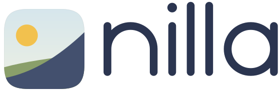

<p align="center">
  <picture>
    <source media="(prefers-color-scheme: dark)" srcset="docs/brand/nilla/wordmark/nilla-wordmark-on-dark.svg">
    
  </picture>
</p>

<p align="center">
  A Chromium browser with a sidebar for your tabs, for macOS, Linux and Windows.<br>
  Free and open source, with no account.
</p>

> **Status: pre-release.** Nilla is a new, independent fork of [Ardia](https://github.com/ardia-browser/ardia). There
> are no Nilla downloads yet. You can build it from source; the first release waits for Nilla's own engine builds
> ("The engine" below).

## What it is

Nilla is one browser UI, written in React Native and TypeScript, on Chromium 157 (Chrome's own framework) through a
thin native layer, the engine. It has a vertical sidebar, split view, profiles, built-in uBlock Origin, import from
other browsers and end-to-end encrypted sync through a folder you choose. Nothing in it needs an account or a server
of ours.

Telemetry, crash and feedback reports, update checks and remote kill switches are **off**: every service endpoint ships
empty ([docs/services.md](docs/services.md)). On macOS and Windows each has one setting to point it at a server later.
On Linux, today's engine fixes those destinations itself, so they stay off whatever the settings say until Nilla's own
engine exists. One outside fetch remains: once you type a `!bang` in the address bar, Nilla refreshes
[Helium](https://github.com/imputnet/helium)'s bang list from `services.helium.imput.net`, at most once a day. Building
from source also downloads the prebuilt engine from Ardia's releases ("The engine" below).

| Platform | App | Engine |
| --- | --- | --- |
| macOS 14+ (Apple Silicon) | `apps/browser` (React Native macOS) | Chromium's framework with our layer (`engine/ardiacore`) |
| Linux x86-64 (Wayland or X11) | `apps/linux` (the shared UI, served by Chromium) | Chromium with `engine/ardiacore-linux` and the `engine/patches/chromium-linux-*` patches |
| Windows 10/11 (x64, ARM64) | `apps/browser/windows` (React Native for Windows) | Chromium's `chrome.dll` (`scripts/windows/engine`) |
| iPhone and Android | `apps/phone` (Expo) | The system WebView; sends tabs to the desktop app |

```
apps/
  browser/            the shared UI (src/), the macOS app (macos/) and the Windows app (windows/)
  linux/              the Linux desktop target: the shared UI with Linux adapters
  phone/              the Expo app for iPhone and Android
  cli/                the nilla-browser command
packages/
  ardiacore/          the engine's app side: Chrome tabs hosted in our views, JS API in src/
  shell/              native menus, shortcuts, windows and views
  shaders/            Metal: New Tab effects and the grained OKLab window backdrop
  import/             import from other browsers (bookmarks, history, passwords, Arc spaces)
  sync/               end-to-end encrypted sync through a shared folder
  core/               pure TypeScript: omnibox input to URL, suggestions, breadcrumbs (tested)
engine/               our patches to Chromium and our Chrome-side code
```

## The engine

Building Chromium takes hours, so the app builds download a prebuilt engine that matches your checkout's `engine/`
folder and check its SHA-256 against a pinned table. Today those engines are **Ardia's**, fetched from the upstream
project's releases (`ardia-browser/ardia`):

| Platform | Pin | Fetch script |
| --- | --- | --- |
| macOS | `packages/ardiacore/prebuilt-engines.tsv` | `packages/ardiacore/scripts/fetch-engine.sh` |
| Linux | `packages/ardiacore/prebuilt-engines-linux.tsv` | `scripts/linux/fetch-engine.sh` |
| Windows | `scripts/windows/engine/prebuilt.json` | `scripts/windows/fetch-engine.ps1` |

Changing anything under `engine/` (or the offline game it packs) changes the engine key, and no prebuilt matches. You
then build the engine yourself: [docs/engine-build.md](docs/engine-build.md) (macOS), [docs/linux-port.md](docs/linux-port.md)
› Building the engine, and [docs/engine-build-windows.md](docs/engine-build-windows.md). A first build takes about five
hours. When your `engine/` is newer than every published engine, `fetch-engine.sh --nearest` builds against the newest
one anyway.

Nilla's own engines, with Nilla's name throughout, are the next milestone. Once they are published, the pins and
fetch scripts point at this repository's releases.

### Known limits

- The newest published engine (`--nearest`) can be older than this checkout's `engine/`, so an app call to a newer
  `ac_*` function can fail on it. That's a gap in the engine you fetched, not in the app.
- Pages and text the engine draws itself (chrome://credits, chrome://settings, notifications, the Web Store's "Add to
  Ardia" button, some error messages) still say Ardia, and the address bar shows `ardia://` for the app's own pages.
- Names today's engines read keep their Ardia spelling until Nilla's engines exist: the `ARDIA_*` environment
  variables (`ARDIA_DATA_DIR` included), the `--ardia-*` switches (`--ardia-ui-dir`), `ArdiaCore` and the `ac_*` calls.
- So builds made this way are for development only. None is published or handed out.

## Build and run

Every platform needs Bun 1.4.4 (`package.json` pins it) and Node 24 (`.nvmrc`; Metro, Vite and jest still run on
it):

```bash
curl -fsSL https://bun.com/install | bash -s bun-v1.4.4                     # macOS and Linux
```

```powershell
iex "& {$(irm https://bun.com/install.ps1)} -Version 1.4.4"                  # Windows
```

Then install, at the repository root and in the two workspaces with their own lockfile:

```bash
bun install --frozen-lockfile
bun install --frozen-lockfile --cwd apps/phone
bun install --frozen-lockfile --cwd extras/raycast-nilla
```

`bun check` type checks the root workspace; type check another package with `bun run --cwd <dir> check`. Builds go
through Bun and keep their own bundlers (Vite, Metro, esbuild); [docs/bundling.md](docs/bundling.md) says which target
uses which.

Every build runs on a data folder of its own. Nilla never reads or writes an installed Ardia's data, keychain items or
sync folder, and a test instance never touches a real profile.

### macOS

Needs Xcode 26+ and CocoaPods.

Start Metro in a terminal of its own and leave it running:

```bash
bun run dev
```

Then, in another terminal, fetch the engine, build the Debug app ad hoc signed and start it:

```bash
bun run pods
engine="$(packages/ardiacore/scripts/fetch-engine.sh --nearest)" || exit 1
ARDIACORE_FRAMEWORK="$engine" xcodebuild -workspace apps/browser/macos/Nilla.xcworkspace -scheme Nilla-macOS \
  -derivedDataPath apps/browser/build -destination 'platform=macOS,arch=arm64' -configuration Debug \
  -xcconfig apps/browser/macos/AdHoc.xcconfig -quiet
open -g -n --env ARDIA_BACKGROUND=1 --env ARDIA_DATA_DIR="$(mktemp -d)" --env ARDIA_REMOTE_DEBUGGING_PORT=9333 \
  apps/browser/build/Build/Products/Debug/Nilla.app
```

`fetch-engine.sh` downloads the prebuilt engine (about 110 MB, once) and prints its path; `ARDIACORE_FRAMEWORK` hands
it to the build, which otherwise fetches only an exact match for your `engine/`. Leave it out when you have a Chromium
tree of your own. `AdHoc.xcconfig` signs without an Apple team. The last line runs the Debug app hidden, on a scratch
data folder, without taking focus; drop `-g` and `ARDIA_BACKGROUND` to see it in front. A Debug build refuses to start
without `ARDIA_DATA_DIR`. Passkeys and saved cards need entitlements tied to an Apple team and don't work in an ad hoc
build.

### Linux

Run Linux builds only inside a disposable VM or a user and mount namespace with a scratch `$HOME`, never on an account
that has, or could later get, an Ardia profile: today's Linux engine picks Ardia's default folder before any app code
runs. Inside that VM or namespace, build the UI, package it with the prebuilt engine and uBlock Origin into a
development tarball, extract it, and start it with `scripts/linux/nilla-dev-run`, which refuses to start without a
scratch `ARDIA_DATA_DIR` and `ARDIA_CONFIG_HOME`:

```bash
bun run --cwd apps/linux build
umask 022
engine="$(scripts/linux/fetch-engine.sh --nearest)" || exit 1
blocker="$(scripts/linux/fetch-ubo.sh)" || exit 1
scratch="$(mktemp -d)"
python3 scripts/linux/package.py --out "$engine" --ui apps/linux/dist --content-blocker "$blocker" \
  --destination "$scratch/nilla-linux-x64.tar.xz"
tar -xJf "$scratch/nilla-linux-x64.tar.xz" -C "$scratch"
ARDIA_DATA_DIR="$scratch/data" ARDIA_CONFIG_HOME="$scratch/config" scripts/linux/nilla-dev-run "$scratch/ardia"
```

The engine refuses a group-writable data folder, hence `umask 022`. The tarball extracts to `ardia/` (its launcher is
`bin/ardia` until Nilla's own engine). Don't install the tarball, `.deb` or AppImage on a host; system packages,
AppArmor and packaging are in [docs/linux-port.md](docs/linux-port.md).

| Task | Command |
| --- | --- |
| UI dev server | `bun run --cwd apps/linux dev` |
| Type check | `bun run --cwd apps/linux check` |
| Host, symbol and module-graph tests | `bun run --cwd apps/linux test:host`, `test:symbols`, `test:graph` |
| Every Linux check CI runs | `scripts/linux/ci-checks.sh` |

### Windows

Windows builds run in CI or in a disposable Windows VM only: today's Windows engine opens Ardia's default profile
before any app code runs, unless `ARDIA_DATA_DIR` is set. The app needs Visual Studio 2022 with the C++ desktop
workload and the Windows SDK 10.0.26100.0. In PowerShell, from `apps/browser`:

```powershell
bun x --no-install react-native run-windows --release --arch x64 --no-launch --no-deploy --no-packager
```

Then, from the repository root, assemble it with a prebuilt engine:

```powershell
scripts/windows/fetch-engine.ps1 -Cpu x64 -Out $env:TEMP\nilla-engine
scripts/windows/assemble.ps1 -App apps/browser/windows/x64/Release -Engine $env:TEMP\nilla-engine -Out $env:TEMP\Nilla
```

Start the assembled app through `scripts/windows/nilla-dev-run.ps1`, which sets `ARDIA_DATA_DIR` to a Nilla-only or
scratch folder first; a development build started without it shows a message and quits. Pass it the app you just
assembled (its launcher is `Ardia.exe` until Nilla's own engine):

```powershell
scripts/windows/nilla-dev-run.ps1 -App $env:TEMP\Nilla\Ardia.exe -DataDir $env:TEMP\nilla-data
```

[docs/windows.md](docs/windows.md) › Test instances has the details. The Windows workflow builds, launches, tours and
installs both CPUs on every pull request that touches shared code.

### Checks

| Task | Command |
| --- | --- |
| Type check the root workspace | `bun check` |
| Every type check, the phone included | `bun run check:all` |
| Every unit test, cached by Turbo | `bun run test` |
| Tests that don't need a Mac | `bun run test:portable` |
| The shaders, compiled offline | `bun run shaders:check` |
| Engine patch series | `python3 engine/patches/series.py check` |

## How Dia's New Tab light works

Dia 1.50 turns this light off along with its rebrand (a painted mark, a single-colour power-up band and a halo around
the bar; `docs/dia-spec.md` › "1.50 Sunglow"), and Nilla leaves it off too. The reconstruction left the tree with it:
`git show f2c0e251:packages/shaders/ios/AreaLightView.swift`.

These findings come from disassembling the Metal libraries in `Dia.app` (v1.49.1) with `xcrun metal-objdump`.
`BoostBrowser_PowerUp.bundle/default.metallib` contains `breathingAreaLightFragment`, which the Swift class
`NewTabPage.NewTabAreaLightView` hosts. The reconstruction was `AreaLightView.swift` (above).

- **The command bar is a light source.** Dia models the bar as a rounded-rectangle area light floating `lift` points
  above the page. Each pixel receives the closed-form irradiance of that rectangle: the solid-angle formula, one
  `atan` term per corner, times 1/2π. Rounded corners subtract (1 − π/4) of each corner square. The result is a
  physically correct penumbra: a higher lift gives a softer, wider glow.
- **Falloff** is reshaped from inverse-square to `(h/d)^falloff`, where `d` is the distance to the emitter's
  rounded-rect surface rather than to its centre.
- **Colour** is Dia's brand spectrum (`ProgressBarColor2…7` in its asset catalog): blue `#0358F7`, steel `#5092C7`,
  lavender `#E1E1FE`, yellow `#FFD400`, orange `#FA3D1D` and magenta `#FD02F5`. It is laid out as a wrapping, slightly
  diagonal gradient that scrolls every 20 s. IQ's 2D simplex noise warps the gradient under the bar, and the warp
  fades out into the penumbra.
- **Dark mode** treats the light as HDR emission and applies the Hable/Uncharted-2 filmic tonemap (white point 11.2),
  with alpha set to Rec.709 luminance. **Light mode** keeps the flat palette colour and uses the irradiance as opacity.
- **Finishing:** alpha fades over the top 50 pt and bottom 200 pt of the view, and ±3/255 triangular dither (Dave
  Hoskins' `hash12`) prevents banding in the long soft falloff.
- **Animation:** the shader itself only scrolls the colours. The lift-off intro and the slow "breathing" come from the
  CPU, which animates `lift` and `intensity`. Those curves live in Dia's Swift code, so the ones here (quartic
  ease-out over 1.1 s, ±7% intensity on a 5.5 s sine) are an approximation.

The **window backdrop** comes from `ARC_WindowThemeUI.bundle` (`gradientFragment` + `renderFragment`). Gradient stops
are stored and mixed in **OKLab**, then converted to linear sRGB and gamma-encoded in the shader. A tiled grain
texture is then multiply-blended on top. `WindowBackdropView` does the same with procedural grain.

Only math and colour values are reused. No Dia images, fonts or binaries are copied into this repo.

## Architecture notes

- **Why Expo SDK 54:** `react-native-macos` tops out at 0.81, which pairs with Expo SDK 54 (whose `ExpoAppDelegate` /
  `ExpoReactNativeFactory` have macOS code paths).
- **Legacy architecture.** react-native-macos 0.81's Fabric support is experimental, so the app runs on the legacy
  architecture. One consequence: Expo's legacy view-manager adapter instantiates a module's *first* view class for
  every view it declares, so each native view has its own module.
- **Metro, not `expo start`.** Metro runs through the react-native-macos CLI. `metro.config.js` redirects
  `react-native` → `react-native-macos` for `platform=macos`, because defining our own `resolveRequest` replaces the
  redirect the CLI would install.
- **No Reanimated.** It has no macOS build for 0.81; animations use RN's `Animated`.
- **Monorepo paths.** `bunfig.toml` sets `[install] linker = "hoisted"` because CocoaPods and Metro resolve
  `react-native-macos` by path. The Podfile rewrites `REACT_NATIVE_PATH` to the hoisted location and raises every
  pod's deployment target to 14.0, since Xcode 26+ rejects the 11.0 some Expo pods declare.
- **Native subviews** are sized in `setFrameSize`, not `layout()`. RN macOS assigns frames directly and never
  autoresizes subviews.
- **Shaders** are Metal source embedded in Swift and compiled at runtime (once per class, cached). This keeps the pods
  free of a metallib build phase.

Feature parity with Dia (everything but its AI) is tracked row by row in
[docs/dia-feature-parity.md](docs/dia-feature-parity.md). [docs/agent-brief.md](docs/agent-brief.md) explains the
architecture in depth.

## Contributing

Issues and pull requests are welcome; see [CONTRIBUTING.md](CONTRIBUTING.md). Contributions come in under the licences
below (Apache-2.0 section 5). There is no CLA.

## License

Nilla as distributed is licensed under the [GNU General Public License v3](LICENSE), because its engine is built with
Helium's GPL-3.0 patches. Nilla's own source files, including those it carries from Ardia, are under the
[Apache License 2.0](LICENSE.Apache-2.0). Third-party components keep their own licences; see [NOTICE](NOTICE). Every
Nilla release will carry its exact source.

## Acknowledgements

Nilla is a fork of **[Ardia](https://github.com/ardia-browser/ardia)** (originally
[mantrakp04/ardia](https://github.com/mantrakp04/ardia)), by Mantra Patel and its contributors. Nearly everything here
started as their work, and the git history keeps every commit of it. Thank you, sincerely, for building it in the open
and for making a fork like this one possible.

Nilla's engine is built on **[Chromium](https://www.chromium.org)** (The Chromium Authors) with
**[Helium](https://github.com/imputnet/helium-chromium)**'s patch series (The Helium Authors, GPL-3.0), which carries
**[ungoogled-chromium](https://github.com/ungoogled-software/ungoogled-chromium)**'s. It bundles
**[uBlock Origin](https://github.com/gorhill/uBlock)**. [NOTICE](NOTICE) has the full list, with every licence.

Nilla is an independent project. It is not affiliated with or endorsed by Ardia or its authors, The Helium Authors, or
The Chromium Authors and Google. Other product names and logos belong to their owners and appear only to identify
those products.
